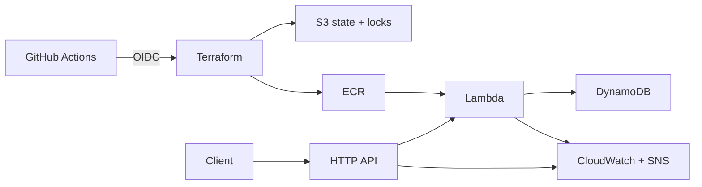

# AWS Cloud Deploy

I deployed a small container API to real AWS with Terraform, and when a broken release went out, it rolled itself back to the last healthy version in under three minutes, with alarm emails sent and everything torn down afterwards.

[](https://github.com/iamnajib71/aws-cloud-deploy/actions/workflows/deploy.yml)
[](LICENSE)


**What this proves**

- **AWS:** a container API ran on AWS Lambda behind API Gateway, storing data in DynamoDB.
- **Terraform:** remote state in S3, and a plan from a fresh clone showed no drift from the live environment.
- **CI/CD with OIDC:** pull-request checks pass on GitHub Actions; keyless OIDC delivery is built and awaiting its first live run.
- **Monitoring and rollback:** a deliberately broken image was rolled back automatically, and both CloudWatch alarm emails arrived.

## At a glance

| | |
|---|---|
| **The problem** | A small team shipping an API to the cloud needs releases that cannot leave customers on a broken version, without paying for a cluster, load balancer or NAT gateway that runs all month. |
| **What I built** | I built Terraform modules for ECR, Lambda, API Gateway, DynamoDB, IAM and CloudWatch, a GitHub Actions pipeline with security scanning, and a release script that checks health after every deploy and restores the previous image if it fails. |
| **Results** | Deployed to AWS and verified: API health, data saved and read back, broken release rolled back in about 2.5 minutes, both alarms emailed, no-drift plan, full teardown with zero resources left. 38 Python tests and 3 Terraform tests pass. |
| **Skills shown** | AWS, Terraform, Infrastructure as Code, GitHub Actions, CI/CD, OIDC, AWS Lambda, API Gateway, DynamoDB, Amazon ECR, Docker, CloudWatch, SNS, AWS Budgets, IAM least privilege, Trivy, tfsec, TFLint, Python, FastAPI |
| **Relevant roles** | Junior DevOps Engineer, Cloud Support Engineer, Junior Cloud Engineer, Graduate Platform Engineer |
| **Try it / evidence** | [Evidence register](docs/evidence.md) · [Live checks](docs/evidence/live-verification.json) · [Rollback record](docs/evidence/live-rollback.json) · [Teardown record](docs/evidence/teardown.json) · [Hosted checks](https://github.com/iamnajib71/aws-cloud-deploy/actions/runs/43839148817) · [Setup guide](docs/setup.md) |

## What I did, step by step

1. **Picked the cheapest runtime that is still real AWS.** I compared Lambda, Fargate and EKS and chose a Lambda container behind an HTTP API: no always-on servers, so the demo costs close to nothing when idle ([decision record](docs/decisions/001-runtime.md)).
2. **Wrote the infrastructure as Terraform modules** with remote state in an encrypted S3 bucket and locking, so every environment can be rebuilt from code ([state design](docs/decisions/003-state.md)).
3. **Built review gates.** Every pull request runs unit tests, linting, Terraform validation, TFLint, tfsec and a Trivy image scan. HIGH or CRITICAL findings fail the check.
4. **Made releases safe.** Each image is tagged with its commit and deployed by digest. After deploying, a script checks `/health`; if it fails, Terraform puts the previous image back and checks again.
5. **Added monitoring and a cost guard.** A CloudWatch dashboard (requests, errors, p95 latency), two alarms that email via SNS, budget alerts at US$1 and US$5, and 3-day log retention.
6. **Deployed it to AWS and broke it on purpose.** I released an image with a failing health check. It was rejected, the healthy version came back automatically, and both alarms emailed me.
7. **Checked it was reproducible, then removed it.** A plan from a fresh clone showed no changes. Then I destroyed everything and confirmed no resources were left.

## Problems I hit and how I solved them

- **My AWS project blocked the GitHub OIDC setup.** The managed policy on my AWS project denies creating identity providers. I added a mode that deploys with a short-lived local sign-in instead, kept the same Terraform and rollback path, and documented the limit rather than claiming a pipeline deploy ([details](docs/free-project.md)).
- **The Lambda concurrency quota was too small to reserve capacity** on a new project. I switched to shared concurrency and kept API Gateway throttling as the burst limit.
- **Terraform did not pick up its variables on Windows** because of how environment-variable names were spelled. I fixed the release script, and the recovery run then completed cleanly.
- **The first pipeline run failed to start** because a reusable workflow was not given the permissions it needed. I passed them explicitly and added a gate so cloud jobs stay off until the AWS bootstrap is ready.

## Architecture



[Architecture notes](docs/architecture.md) · [Design decisions](docs/decisions/) · [Security boundaries](docs/security.md) · [Runbook: deploy, rollback, alarms](docs/runbook.md)

## Use it yourself

This repository is also a reusable template. Create your own copy with **Use this template**, then:

```sh
git clone https://github.com/YOUR-OWNER/YOUR-REPOSITORY.git
cd YOUR-REPOSITORY
python -m cloud_deploy init      # private local config, no AWS calls
python -m cloud_deploy doctor    # checks prerequisites
```

Follow the [first-time setup](docs/setup.md) to create state and OIDC trust with your own short-lived AWS session. Other commands: `doctor --aws`, `health <url>` and `destroy`. [CLI reference](docs/cli.md) · [Customise the API](docs/customise.md)

Run the tests (no AWS account needed):

```sh
python -m pip install -r requirements-dev.txt
python -m ruff check app cloud_deploy scripts tests
python -m pytest -q
```

## Cost

The design has no NAT gateway, cluster or load balancer, so it aims for a very small bill at light traffic. **There is no hard spending cap.** Budget alerts only notify after spending happens, and `destroy` keeps the state bucket, which can still cost a little. See the [cost guide](docs/cost.md).

## Honest limits

- The live deploy and rollback ran from a short-lived local sign-in, not from a GitHub Actions run. Linked pipeline runs are still pending.
- Prod was never deployed, so the manual approval step has not been exercised.
- Measured monthly cost, console screenshots and a demo GIF are still pending.
- The example API is public and unauthenticated; use fictional data only.
- Rollback restores the previous image, not earlier infrastructure or deleted data.
- The demo was time-boxed and destroyed; there is no permanent endpoint.

## Built by Nazmul Hassan

[LinkedIn](https://www.linkedin.com/in/iamnajib71) · [GitHub](https://github.com/iamnajib71) · [Contributing](CONTRIBUTING.md) · [Security](SECURITY.md) · [MIT license](LICENSE)
