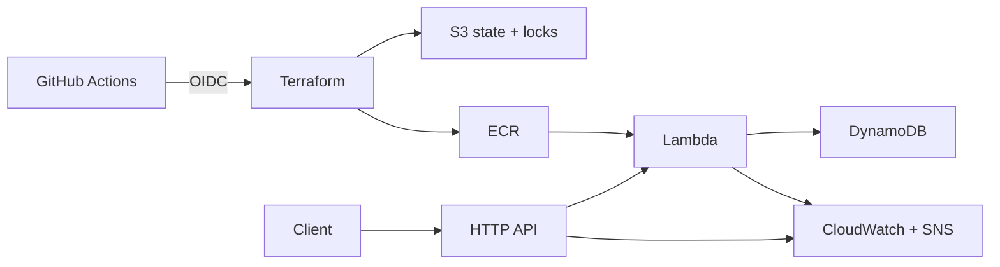

# AWS Cloud Deploy

A reusable starter and CLI for shipping small container APIs to AWS with Terraform, keyless GitHub Actions and readiness-based rollback.

[](https://github.com/iamnajib71/aws-cloud-deploy/actions/workflows/deploy.yml)
[](LICENSE)
[](docs/evidence.md)

**Your container → ECR → Lambda → HTTP API.** DynamoDB storage, monitoring, release checks and teardown are included. No cluster, NAT gateway or always-on load balancer.

[Use this template](https://github.com/new?template_name=aws-cloud-deploy&template_owner=iamnajib71) · [Setup guide](docs/setup.md) · [CLI reference](docs/cli.md) · [Contributing](CONTRIBUTING.md)

> **Verified AWS demo:** real item storage, automatic recovery from a broken image and a clean-clone plan with no drift are [recorded](docs/evidence.md). The workload and state bucket were removed after verification; this repository is a deployable template, with no permanent shared endpoint. Deployment used a temporary local session. GitHub OIDC delivery, production promotion, measured monthly cost and owner screenshots remain pending.

What this proves:

- **AWS:** a container API ran on Lambda with HTTP API and DynamoDB storage.
- **Terraform:** remote state and a clean-clone plan reproduce the live dev environment.
- **CI/CD with OIDC:** verification passes; OIDC delivery is implemented but awaits a compatible project.
- **Monitoring and rollback:** both alarm emails arrived during the drill; a broken image automatically recovered.

## Start here

Create your own repository with **Use this template**, then clone it:

```sh
git clone https://github.com/YOUR-OWNER/YOUR-REPOSITORY.git
cd YOUR-REPOSITORY
python -m cloud_deploy init
python -m cloud_deploy doctor
```

The CLI itself needs only Python 3.11 or newer. `init` asks for your repository, region, unique state bucket and notification email. It creates an ignored local config, preserves existing settings and does not contact AWS.

`doctor` tells you which deployment prerequisites need attention. Once they are ready, follow the [first-time setup](docs/setup.md) to create state and OIDC trust with your own short-lived AWS session. The CLI never runs that first apply for you.

## What you get

| Capability | How it works |
|---|---|
| Private local setup | Interactive config, validation and no silent overwrites |
| Preflight diagnostics | Tool/version checks, Docker engine check and optional read-only AWS session check |
| Keyless delivery | Separate GitHub OIDC roles for plans, dev and prod; no stored AWS access keys |
| Repeatable releases | Immutable commit tags, digest-pinned deployment and same-image production promotion |
| Failure recovery | Post-deploy readiness checks; Terraform restores the previous image when the candidate fails |
| Built-in monitoring | Structured logs, request/error/p95 dashboard and SNS alarms |
| Cost controls | Budget alerts, request throttling, short log retention and explicit teardown |
| Review gates | Tests, Terraform validation, TFLint, tfsec, image scan and sanitised PR plan summaries |

## Commands

```sh
# Create your private configuration
python -m cloud_deploy init

# Check local prerequisites; optionally verify your AWS session
python -m cloud_deploy doctor
python -m cloud_deploy doctor --aws

# Check an already deployed API
python -m cloud_deploy health https://YOUR-API-URL

# Remove dev, prod and bootstrap resources; keep remote state
python -m cloud_deploy destroy
```

Each command has `--help`. [Full command reference and troubleshooting →](docs/cli.md)

## Deploy from GitHub

1. Create a repository from this template and complete the [owner bootstrap](docs/setup.md).
2. Add the documented GitHub secrets and configure `dev` / `prod` environments in **your** repository.
3. Require approval for prod, then set `BOOTSTRAP_READY=true`.
4. Merge a change to `main`: verification runs, dev deploys and readiness is checked.
5. Approve prod to promote the exact digest tested in dev.

A failing candidate restores the previous image and leaves the workflow red to report the rejected release. The first deployment has no previous image. [Runbook and rollback drill →](docs/runbook.md)

## Bring your own API

Start with the included FastAPI example: `/health`, `/items` and `/metrics`. Replace the handler and tests while preserving the readiness contract. This starter targets Lambda-compatible containers, rather than arbitrary long-running Docker services.

[Customisation guide →](docs/customise.md)

After deploying your own installation, check readiness:

```sh
curl --fail https://YOUR-API-URL/health
```

The API also exposes `/items` and `/metrics`. It is public and rate-limited: use fictional data until you add authentication. Projects using the new AWS Free experience can follow the [local-session route](docs/free-project.md); the OIDC route needs permission to create an identity provider. The recorded upstream demo was time-boxed and is not a hosted service.



[Architecture](docs/architecture.md) · [Design decisions](docs/decisions/) · [Security boundaries](docs/security.md)

## Cost and limits

The target is a very small bill at light traffic with applicable free allowance. **There is no guaranteed free deployment or hard spending cap.** Budgets notify after spending, and public traffic can cost money.

`destroy` retains the state bucket and its contents, which can still incur charges. Use the [cost guide](docs/cost.md) and [cleanup checklist](docs/runbook.md#destroy-and-verify) before claiming a zero footprint.

Current boundaries:

- One installation per isolated AWS account, in one region; resource names use a fixed prefix.
- The example API is public and unauthenticated. Use fictional data until you add authorisation.
- Recovery restores the previous image, not prior infrastructure or deleted data.
- `/metrics` is per Lambda execution environment; CloudWatch supplies aggregate monitoring.
- A live demo recording, owner screenshots and measured cloud costs remain pending.

## Verification

[Hosted checks](https://github.com/iamnajib71/aws-cloud-deploy/actions/workflows/deploy.yml) · [Recorded local results](docs/evidence/local-validation.md) · [Evidence register](docs/evidence.md)

Upstream verification does not prove that a repository generated from this template is deployed. Replace evidence links with your own runs when validating your installation.

## Contribute

Try setup on a fresh machine, report a reproducible issue or improve a specific command. No AWS account is needed for the Python tests.

```sh
python -m pip install -r requirements-dev.txt
python -m ruff check app cloud_deploy scripts tests
python -m pytest -q
```

[Contribution guide](CONTRIBUTING.md) · [Report a bug](https://github.com/iamnajib71/aws-cloud-deploy/issues/new/choose) · [Security reporting](SECURITY.md)

Maintained by [Nazmul Hassan](https://github.com/iamnajib71). [MIT license](LICENSE).
