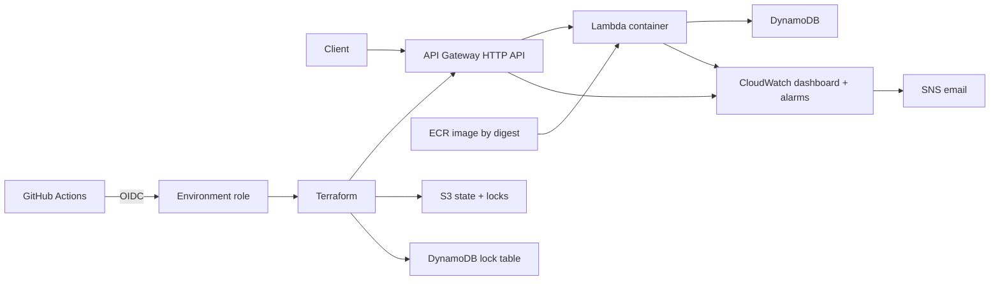

# AWS Cloud Deploy

A small API delivery project designed to give a support team repeatable AWS releases, health checks and automatic recovery from a faulty release.

Demo recording: **pending owner-run AWS deployment**; see the [evidence register](docs/evidence.md).

[](https://github.com/iamnajib71/aws-cloud-deploy/actions/workflows/ci.yml)
[](LICENSE)
[](app/main.py)

## At a glance

| | |
|---|---|
| **The problem** | A small service team needs to release API changes without manually managing servers or leaving an expensive cloud lab running. |
| **What I built** | I built a containerised API, infrastructure definitions, delivery workflows and recovery scripts. I separated the owner bootstrap from routine releases and documented the handover. |
| **Results** | Local verification is recorded in [validation evidence](docs/evidence/local-validation.md). Live deployment, rollback and billing results are pending. |
| **Skills shown** | AWS, Terraform, GitHub Actions, OIDC, Docker, Python, DynamoDB, CloudWatch, incident response. |
| **Relevant roles** | Junior DevOps Engineer, Cloud Support Engineer, Junior Platform Engineer. |
| **Try it / evidence** | [Quick start](#quick-start) · [evidence register](docs/evidence.md) · [architecture](docs/architecture.md) · [runbook](docs/runbook.md). |

What this project is intended to prove:

- **AWS:** a real API on Lambda, API Gateway, ECR and DynamoDB; live evidence pending.
- **Terraform:** separate state, bootstrap and workload roots with remote locking.
- **CI/CD with OIDC:** short-lived credentials, image promotion and protected production releases.
- **Monitoring and rollback:** dashboards, alarms, readiness checks and previous-image recovery.

## What I did, step by step

1. Chose a small API and serverless runtime to avoid paying for idle servers.
2. Defined encrypted remote state and separate bootstrap resources.
3. Restricted deployment roles to the repository, environment and application resources.
4. Added source tests, infrastructure checks and container vulnerability gates.
5. Implemented readiness checks and restoration of the previous image through Terraform.
6. Documented owner setup, deployment drills, evidence capture and teardown.

## Problems I hit and how I solved them

- The README standard was outside the new project folder. I followed the supplied source and kept live results explicitly pending.
- Windows sandbox restrictions blocked the async test loop and Terraform provider communication. I ran those checks with the required local process access; see [validation](docs/evidence/local-validation.md).
- Encryption with a dedicated key adds a recurring cost to a tiny lab. I used built-in encryption for state and recorded the narrow notification exception in [security](docs/security.md).
- A failed image release can leave Terraform state out of sync if recovery bypasses Terraform. The recovery script applies the previous digest through Terraform and checks readiness again.

## Architecture



No network module is needed: Lambda uses its managed network and public AWS service endpoints. [Design details](docs/architecture.md).

## Quick start

Local tests, with Python installed:

```sh
python -m venv .venv
# Activate .venv for your shell, then:
python -m pip install -r requirements-dev.txt
python -m pytest -q
python -m ruff check app scripts tests
```

Cloud deployment requires the owner steps in [setup](docs/setup.md). They include account creation, root MFA, a notification email and the first bootstrap apply. The workflow cannot perform that initial trust setup itself.

After setup, merge to `main` for dev; approve the `prod` environment to promote the same image digest. To remove dev, prod and bootstrap resources using owner credentials:

```sh
make destroy
# Equivalent without Make:
python scripts/manage.py destroy
```

The state bucket and its encrypted contents remain. **Retained storage can still cost money**; billing rounds, delayed charges and account eligibility prevent an unconditional $0 promise. See [cost](docs/cost.md) and [teardown verification](docs/runbook.md#destroy-and-verify).

## Results and evidence

- [Local checks](docs/evidence/local-validation.md)
- Green AWS deploy workflow: **pending**
- Deliberately broken deploy with verified rollback: **pending**
- Clean-clone no-drift plan: **pending**
- Cost Explorer screenshot and owner screenshots: **pending**

See the [evidence register](docs/evidence.md) for capture criteria. There are no invented workflow links, screenshots or billing results.

## Project structure

```text
app/                    API and Lambda adapter
tests/                  API and recovery tests
infra/state/            owner-managed retained state bucket
infra/bootstrap/        OIDC, delivery/runtime roles, ECR, budget, lock table
infra/live/             dev/prod workload using separate backend keys
infra/modules/          ecr, iam, app, observability
.github/workflows/      verify, plan, deploy and environment release
scripts/                recovery and teardown commands
docs/                   setup, runbook, decisions, costs and evidence
```

## Honest limits

- AWS execution and real billing have not been verified. Cloud release jobs remain gated until the owner completes bootstrap and supplies the private configuration.
- Budgets are delayed alerts, not spending caps. A public endpoint can exceed the target budget under sustained traffic.
- `/metrics` is per Lambda execution environment; CloudWatch supplies service-wide monitoring. Item listing is a bounded demo scan, and the demo has no user authentication.
- Recovery restores an image, not prior infrastructure definitions or deleted data. A first deployment has no earlier image to restore.
- A live demo GIF and owner screenshots remain pending. Profile claims and repository pinning must wait for deployment evidence.

## Built by Nazmul Hassan

[LinkedIn](https://www.linkedin.com/in/iamnajib71) · [GitHub](https://github.com/iamnajib71)
