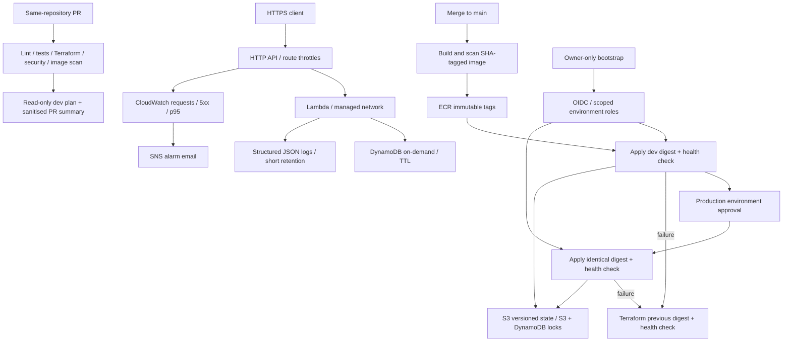

# Architecture

The proposed deployment serves a tiny FastAPI application through a Lambda-compatible container. It is independent of the local Kubernetes lab so it has no dependency on that lab's private endpoints or message worker.

`infra/state` retains the encrypted, private state bucket. `infra/bootstrap` owns the shared ECR repository, OIDC provider, runtime and delivery roles, lock table and account-wide budget. Its backend uses S3 native locking so it can remove the DynamoDB lock table during teardown. `infra/live` uses one root with isolated dev/prod backend keys and both locking methods.

There is no VPC, NAT gateway, load balancer, EKS cluster, ECS service or continuously running worker. DynamoDB uses AWS-managed encryption, on-demand billing and point-in-time recovery. Item expiry is asynchronous; TTL is not a storage quota.

The request path is publicly accessible by design and stores fictional demo items only. HTTPS is supplied by API Gateway. Four explicit routes are allowed. API request throttles and Lambda concurrency reduce bursts but cannot impose an account spending cap.

The dashboard uses HTTP API metrics `Count`, `5xx`, and `Latency` with `p95`, filtered by `ApiId`. It does not enable paid route-level metrics. The error alarm uses a percentage expression; the latency alarm uses a percentile. Confirm both with owner-generated traffic and screenshots before claiming operational monitoring.

Sources: [HTTP API metrics](https://docs.aws.amazon.com/apigateway/latest/developerguide/http-api-metrics.html), [Lambda Python container support](https://docs.aws.amazon.com/lambda/latest/dg/python-image.html).
